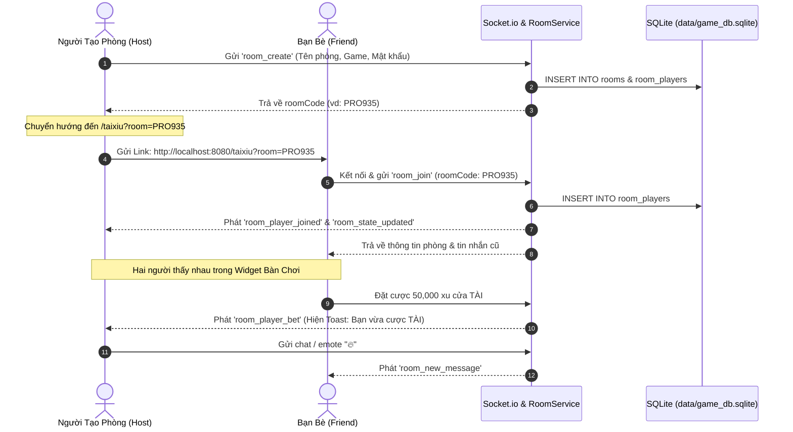

# 📘 HƯỚNG DẪN TRIỂN KHAI & PHÁT TRIỂN HỆ THỐNG
# LUCKY TABLE CASINO PORTAL & MULTIPLAYER ENGINE

Tài liệu này cung cấp hướng dẫn toàn diện từ kiến trúc, cài đặt môi trường, cấu trúc mã nguồn, cơ sở dữ liệu SQLite, hệ thống phòng chơi bạn bè (Multiplayer) đến quy trình thêm tính năng/trò chơi mới cho các lập trình viên tham gia phát triển dự án.

---

## 📑 MỤC LỤC
1. [Tổng Quan Dự Án](#1-tổng-quan-dự-án)
2. [Ngăn Xếp Công Nghệ (Tech Stack)](#2-ngăn-xếp-công-nghệ-tech-stack)
3. [Cấu Trúc Thư Mục Dự Án](#3-cấu-trúc-thư-mục-dự-án)
4. [Yêu Cầu Môi Trường & Cài Đặt](#4-yêu-cầu-môi-trường--cài-đặt)
5. [Cơ Sở Dữ Liệu SQLite (Persistence Layer)](#5-cơ-sở-dữ-liệu-sqlite-persistence-layer)
6. [Hệ Thống Multiplayer & Chơi Chung Bạn Bè](#6-hệ-thống-multiplayer--chơi-chung-bạn-bè)
7. [Thuật Toán Cân Bằng Cảm Xúc (Smart Pity Engine)](#7-thuật-toán-cân-bằng-cảm-xúc-smart-pity-engine)
8. [Tài Liệu REST API & Realtime Socket.io](#8-tài-liệu-rest-api--realtime-socketio)
9. [Hướng Dẫn Tích Hợp Một Trò Chơi Mới](#9-hướng-dẫn-tích-hợp-một-trò-chơi-mới)
10. [Quy Chuẩn Code & Đóng Góp (Contribution Rules)](#10-quy-chuẩn-code--đóng-góp-contribution-rules)

---

## 1. Tổng Quan Dự Án

**Lucky Table Casino Portal** là nền tảng game giải trí Web Realtime cao cấp gồm nhiều trò chơi sòng bài & dân gian:
- **🎲 Tài Xỉu 3D — Bát Rồng Vàng**: Chu kỳ 15s đếm ngược, xúc xắc 3D vật lý ngẫu nhiên mật mã và Smart Pity Engine.
- **🦀 Bầu Cua 3D — Hoàng Gia**: Đĩa sứ rồng, hiệu ứng lắc tự động 15s, tương tác kéo mở bát và âm thanh sống động.
- **🃏 Ba Cây VIP — Chia Bài 3D**: Bộ bài 36 lá, hiệu ứng chia bài bay vòng tròn từ nọc, nặn bài (card squeezing), quy luật 10 điểm ăn x3 và cướp Nhà Cái.
- **👥 Chơi Chung Với Bạn Bè (Multiplayer Rooms)**: Cho phép tạo phòng riêng (hoặc công khai), chia sẻ mã/link phòng, chat phòng và hiển thị cược của bạn bè theo thời gian thực.
- **🪙 Cổng Thanh Toán & Quản Lý Tài Khoản**: Nạp tiền mã QR, rút tiền về ngân hàng, xem lịch sử giao dịch và bảng xếp hạng VIP.

---

## 2. Ngăn Xếp Công Nghệ (Tech Stack)

| Tầng | Công nghệ sử dụng | Mục đích |
|---|---|---|
| **Backend Runtime** | Node.js (>= v18, khuyến nghị v20+) | Nền tảng thực thi server hiện đại chuẩn ES Modules (`"type": "module"`) |
| **Web Server** | Express.js 4.x | Cung cấp RESTful API, định tuyến SPA và phục vụ static assets |
| **Realtime Engine** | Socket.io 4.x | Giao tiếp 2 chiều độ trễ cực thấp cho cược, kết quả, chat phòng |
| **Database** | SQLite3 (`sql.js`) | Lưu trữ bền vững vào đĩa (`data/game_db.sqlite`), không cần cài MySQL/MongoDB |
| **Frontend Core** | Vanilla HTML5, CSS3, JavaScript (ES6+) | Tối ưu tốc độ tải trang, không phụ thuộc nặng nề vào bundler phức tạp |
| **Graphics & 3D** | Three.js (WebGL), Canvas 2D | Render xúc xắc 3D, bát rồng, quân vị, hoa đào rơi và pháo hoa |
| **Audio** | Web Audio API / Synthesizer | Phát âm thanh lắc xúc xắc, chia bài, tiếng phỉnh và nhạc thắng lớn |

---

## 3. Cấu Trúc Thư Mục Dự Án

```
game/
├── package.json              # Khai báo dependencies & scripts
├── server.js                 # Entrypoint khởi chạy server Express & Socket.io
├── DEVELOPMENT_GUIDE.md      # Tài liệu hướng dẫn phát triển (file này)
├── README.md                 # Giới thiệu dự án
│
├── data/                     # Thư mục lưu trữ database SQLite
│   └── game_db.sqlite        # File cơ sở dữ liệu SQLite nhị phân bền vững
│
├── src/                      # MÃ NGUỒN BACKEND
│   ├── app.js                # Cấu hình Express app, middlewares, static routes
│   ├── config/
│   │   ├── appConfig.js      # Cấu hình cổng port (8080), đường dẫn tĩnh, CORS
│   │   └── gameConfig.js     # Cấu hình tham số ván chơi, tỷ lệ Pity, tiền khởi tạo
│   ├── controllers/
│   │   └── gameController.js # Xử lý các request API (User, Room, Config, News)
│   ├── database/
│   │   └── db.js             # SQLite Engine: quản lý kết nối, CRUD bảng, auto-save
│   ├── routes/
│   │   └── api.js            # Khai báo các endpoint REST API `/api/*`
│   ├── services/
│   │   ├── diceService.js    # Sinh ngẫu nhiên xúc xắc chuẩn crypto
│   │   ├── emotionEngine.js  # Thuật toán Pity: All-in 50/50 & cứu thua
│   │   ├── gameEngine.js     # Game loop trung tâm: Betting -> Rolling -> Result
│   │   ├── roomService.js    # Logic nghiệp vụ phòng chơi bạn bè
│   │   └── userService.js    # Quản lý số dư, nạp/rút tiền, trả thưởng cược
│   ├── sockets/
│   │   └── gameSocket.js     # Lắng nghe & phát sự kiện realtime Socket.io
│   └── utils/
│       └── logger.js         # Hệ thống ghi log console có màu sắc
│
└── public/                   # MÃ NGUỒN FRONTEND
    ├── index.html            # Trang chủ Portal Lobby (Kho game, Nạp/Rút, Danh sách phòng)
    ├── taixiu.html           # Màn chơi Tài Xỉu 3D Bát Rồng Vàng
    ├── baucua.html           # Màn chơi Bầu Cua 3D Hoàng Gia
    ├── bacay.html            # Màn chơi Ba Cây VIP Thần Bài
    ├── assets/               # Hình ảnh, icon chip cược, bát rồng, avatar
    ├── css/
    │   ├── portal.css        # Giao diện Trang chủ sảnh chính, modal ví tiền
    │   ├── style.css         # Style game Tài Xỉu bàn tròn
    │   └── room-overlay.css  # Giao diện Widget phòng bạn bè & chat overlay
    └── js/
        ├── portal.js         # Controller cho Trang chủ sảnh chính
        ├── game.js           # Client controller cho game Tài Xỉu
        ├── dice.js           # Three.js 3D render xúc xắc Tài Xỉu
        ├── storage.js        # Cache dữ liệu local client
        └── room-overlay.js   # Component phòng chơi bạn bè dùng chung cho mọi game
```

---

## 4. Yêu Cầu Môi Trường & Cài Đặt

### 4.1. Yêu Cầu Hệ Thống
- **Hệ điều hành**: Linux (Ubuntu/Debian), macOS, hoặc Windows.
- **Node.js**: Phiên bản 18.x hoặc 20.x trở lên (`node -v`).
- **NPM**: Phiên bản 9.x trở lên (`npm -v`).
- **Trình duyệt**: Chrome, Firefox, Safari, Edge hỗ trợ WebGL và ES Modules.

### 4.2. Các Bước Cài Đặt
1. **Clone repository về máy**:
   ```bash
   git clone <URL_REPOSITORY>
   cd game
   ```

2. **Cài đặt các thư viện cần thiết**:
   ```bash
   npm install
   ```

3. **Kiểm tra file cấu hình**:
   - File cấu hình server nằm tại [`src/config/appConfig.js`](file:///home/snine/int-datnd/game/src/config/appConfig.js). Cổng mặc định là `8080`.
   - Có thể cấu hình biến môi trường qua file `.env` nếu cần đổi cổng:
     ```env
     PORT=8080
     NODE_ENV=development
     CORS_ORIGIN=*
     ```

### 4.3. Khởi Chạy Server

#### Chế độ Development (Tự động tải lại khi sửa code):
```bash
npm run dev
# hoặc: node --watch server.js
```

#### Chế độ Production / Background Service:
```bash
npm start
# hoặc chạy nền:
nohup node server.js > server.log 2>&1 &
```

Sau khi khởi chạy thành công, truy cập:
- **Trang chủ sảnh game**: [http://localhost:8080/](http://localhost:8080/)
- **Game Tài Xỉu 3D**: [http://localhost:8080/taixiu](http://localhost:8080/taixiu)
- **Game Bầu Cua 3D**: [http://localhost:8080/baucua](http://localhost:8080/baucua)
- **Game Ba Cây VIP**: [http://localhost:8080/bacay](http://localhost:8080/bacay)
- **Kiểm tra tình trạng API**: [http://localhost:8080/api/health](http://localhost:8080/api/health)

---

## 5. Cơ Sở Dữ Liệu SQLite (Persistence Layer)

Hệ thống sử dụng **SQLite3** thông qua WebAssembly module `sql.js`, lưu toàn bộ cấu trúc bảng và dữ liệu vào file vật lý [`data/game_db.sqlite`](file:///home/snine/int-datnd/game/data/game_db.sqlite).

### 5.1. Lược Đồ Bảng (Database Schema)

#### Bảng `users`
| Cột | Kiểu | Mô tả |
|---|---|---|
| `id` | TEXT PRIMARY KEY | ID định danh người chơi (vd: `user_abc123` hoặc `Player001`) |
| `username` | TEXT NOT NULL | Tên hiển thị người chơi |
| `balance` | INTEGER | Số dư xu hiện tại (mặc định: `10000`) |
| `vip_level` | INTEGER | Cấp bậc VIP (1 - 5) |
| `avatar` | TEXT | Đường dẫn ảnh đại diện |
| `stats` | TEXT (JSON) | Thống kê số ván cược, chuỗi thắng/thua, tổng cược |
| `transactions` | TEXT (JSON) | Lịch sử nạp tiền, rút tiền |
| `bet_history` | TEXT (JSON) | 50 ván cược gần nhất |
| `created_at` | TEXT | Thời gian tạo tài khoản (ISO timestamp) |
| `last_active` | TEXT | Lần hoạt động cuối cùng |

#### Bảng `rooms`
| Cột | Kiểu | Mô tả |
|---|---|---|
| `room_code` | TEXT PRIMARY KEY | Mã phòng ngắn độc nhất (vd: `PRO935`, `GOLD959`) |
| `room_name` | TEXT NOT NULL | Tên phòng do người chơi đặt |
| `game_type` | TEXT NOT NULL | Thể loại game (`taixiu`, `baucua`, `bacay`) |
| `host_id` | TEXT NOT NULL | User ID của chủ phòng |
| `host_name` | TEXT NOT NULL | Tên hiển thị của chủ phòng |
| `password` | TEXT | Mật khẩu phòng (chuỗi rỗng nếu công khai) |
| `max_players` | INTEGER | Số người chơi tối đa (4, 8, 12) |
| `status` | TEXT | Trạng thái phòng (`open`, `playing`, `closed`) |
| `created_at` | TEXT | Thời gian tạo phòng |

#### Bảng `room_players`
Lưu danh sách người chơi đang ở trong từng phòng:
- `id` (AUTOINCREMENT), `room_code`, `user_id`, `username`, `avatar`, `balance`, `is_host`, `is_ready`, `joined_at`.
- Ràng buộc: `UNIQUE(room_code, user_id)` tránh trùng lặp người chơi.

#### Bảng `room_messages`
Lưu lịch sử tin nhắn và thông báo cược của phòng:
- `id`, `room_code`, `user_id`, `username`, `content`, `msg_type` (`chat`, `bet`, `win`, `system`), `created_at`.

#### Bảng `rounds` & `config`
- `rounds`: Lịch sử 100 ván xúc xắc Tài Xỉu gần nhất (`id`, `game_type`, `dices`, `total`, `result`, `created_at`).
- `config`: Lưu cấu hình Smart Pity và tỷ lệ thưởng dưới dạng JSON key-value.

### 5.2. Nguyên Tắc Lập Trình Với SQLite (`src/database/db.js`)
1. **Tránh lỗi bind `undefined`**: Khi bind parameters vào `stmt.run()`, luôn sử dụng helper `this.sanitizeParams(params)` để chuyển `undefined` về `null`.
2. **Auto-save (Debounced Sync)**: Mỗi khi có thao tác ghi dữ liệu, phương thức `this.scheduleSave()` sẽ đợi 150ms và xuất file `.sqlite.tmp` rồi rename nguyên tử (atomic write) nhằm đảm bảo file không bao giờ bị hỏng khi server bị ngắt đột ngột.

---

## 6. Hệ Thống Multiplayer & Chơi Chung Bạn Bè

Hệ thống cho phép người chơi tạo phòng riêng và mời bạn bè vào cùng so tài.

### 6.1. Luồng Hoạt Động (Flow)


### 6.2. Component `RoomOverlay` (`public/js/room-overlay.js`)
Component tự động nhúng vào mọi trang game:
- Đọc query param `?room=CODE` trên thanh địa chỉ.
- Tự động join phòng Socket.
- Render widget góc trái dưới màn hình:
  - Xem danh sách người chơi trong phòng.
  - Khung chat & nút thả biểu cảm nhanh (`🎉`, `🔥`, `💰`, `🍻`, `👏`, `🚀`).
  - Nút **"📋 Copy Link"** tự sinh URL kèm mã phòng vào Clipboard.
  - Toast thông báo tức thời khi bạn bè trong phòng cược hoặc thắng lớn.

---

## 7. Thuật Toán Cân Bằng Cảm Xúc (Smart Pity Engine)

Nằm tại [`src/services/emotionEngine.js`](file:///home/snine/int-datnd/game/src/services/emotionEngine.js). Đây là điểm khác biệt lớn của dự án giúp nâng cao trải nghiệm giải trí:

1. **Cơ chế All-in Hồi Hộp (All-in Dramatic Mode)**:
   - Khi người chơi đặt cược hơn 70% số vốn của mình.
   - Thuật toán khóa tỷ lệ 50% thắng / 50% thua cân bằng, tránh trường hợp bị nuốt chửng ngay lập tức.
2. **Cơ chế Cứu Thua (Loss-streak Mercy Protection)**:
   - Nếu người chơi thua liên tiếp từ 2 ván trở lên (`currentLossStreak >= 2`).
   - Tỷ lệ ra cửa người chơi chọn được nâng từ 50% lên **75% - 85%** để giúp người chơi lấy lại tinh thần.
3. **Cơ chế Kìm Thắng (Win-streak Cooling)**:
   - Nếu người chơi thắng chuỗi liên tiếp $\ge 4$ ván, xác suất được cân bằng lại về trạng thái ngẫu nhiên thuần túy của sòng bạc.
4. **Bật/Tắt Admin**:
   - Thuật toán có thể bật/tắt tức thời từ popup Cài đặt `⚙️` trên giao diện người dùng.

---

## 8. Tài Liệu REST API & Realtime Socket.io

### 8.1. Các Endpoint REST API chính

| Method | Endpoint | Mô tả | Body mẫu |
|---|---|---|---|
| `GET` | `/api/health` | Kiểm tra trạng thái máy chủ & database | Không |
| `GET` | `/api/game/status` | Lấy snapshot trạng thái ván cược hiện tại | Query: `?userId=...` |
| `GET` | `/api/game/history` | Lấy lịch sử các ván trước | Query: `?limit=30` |
| `GET` | `/api/user/:userId` | Lấy thông tin tài khoản, số dư, VIP | Không |
| `POST` | `/api/user/:userId/deposit` | Nạp xu vào tài khoản | `{"amount": 50000, "method": "BANK_QR"}` |
| `POST` | `/api/user/:userId/withdraw` | Rút xu về tài khoản ngân hàng | `{"amount": 20000, "bankName": "MB", "accountNumber": "999"}` |
| `POST` | `/api/user/:userId/sync-balance` | Đồng bộ số dư từ các game con | `{"balance": 150000}` |
| `GET` | `/api/rooms` | Lấy danh sách các phòng đang mở | Query: `?gameType=taixiu` |
| `GET` | `/api/rooms/:roomCode` | Lấy chi tiết thông tin phòng & tin nhắn | Không |
| `POST` | `/api/rooms/create` | Tạo phòng chơi mới | `{"hostId": "u1", "hostName": "Nam", "gameType": "taixiu", "maxPlayers": 8}` |
| `POST` | `/api/rooms/:roomCode/join` | Tham gia vào phòng chơi | `{"userId": "u2", "username": "Hoa", "password": ""}` |

### 8.2. Các Sự Kiện Realtime Socket.io

#### Lắng nghe từ Client (`socket.on`):
- `place_bet`: `{ door: 'tai', amount: 5000 }` - Đặt cược ván.
- `cancel_bet`: Hủy cược khi còn trong thời gian chờ.
- `trigger_roll`: Bấm xóc sớm (nếu tất cả người chơi đã sẵn sàng).
- `room_create`: `{ roomName, gameType, password, maxPlayers }` - Tạo phòng bạn bè.
- `room_join`: `{ roomCode, password }` - Vào phòng bạn bè.
- `room_leave`: `{ roomCode }` - Rời phòng.
- `room_send_chat`: `{ roomCode, content }` - Gửi tin nhắn / emoji vào phòng.
- `room_sync_custom_bet`: `{ roomCode, door, amount, gameType }` - Đồng bộ cược từ game con.

#### Server phát tới Client (`socket.emit` / `io.to().emit`):
- `sync_state`: Đồng bộ dữ liệu ván cược ban đầu khi vừa kết nối.
- `round_phase`: Chuyển pha (`BETTING`, `ROLLING`, `RESULT`).
- `round_result`: Công bố xúc xắc, tổng điểm, cửa thắng và tiền trả thưởng.
- `room_state_updated`: Cập nhật lại danh sách người chơi trong phòng.
- `room_new_message`: Tin nhắn mới trong phòng.
- `room_player_bet`: Thông báo bạn bè vừa đặt cược.

---

## 9. Hướng Dẫn Tích Hợp Một Trò Chơi Mới

Để thêm một trò chơi mới (ví dụ: *Xóc Đĩa 3D* hoặc *Tiến Lên Miền Nam*), hãy thực hiện 4 bước chuẩn hóa sau:

### Bước 1: Tạo Giao Diện HTML/CSS
1. Tạo file HTML mới trong thư mục `public/` (ví dụ: `public/xocdia.html`).
2. Nhúng CSS dùng chung và component phòng bạn bè vào thẻ `<head>`:
   ```html
   <link rel="stylesheet" href="/css/room-overlay.css">
   <script src="/socket.io/socket.io.js"></script>
   <script src="/js/room-overlay.js"></script>
   ```

### Bước 2: Đồng Bộ Số Dư Ví & Cược Bạn Bè
Trong file JS của game mới, gọi hàm tiện ích:
```javascript
// Khi người chơi đặt cược trong game:
if (window.RoomOverlay && window.RoomOverlay.syncCustomBet) {
  window.RoomOverlay.syncCustomBet('CHẴN', 50000, 'xocdia');
}

// Khi kết thúc ván, lưu số dư mới lên server:
fetch(`/api/user/${userId}/sync-balance`, {
  method: 'POST',
  headers: { 'Content-Type': 'application/json' },
  body: JSON.stringify({ balance: currentBalance })
});
```

### Bước 3: Đăng Ký Route Trong Express (`src/app.js`)
Thêm route điều hướng trong [`src/app.js`](file:///home/snine/int-datnd/game/src/app.js):
```javascript
app.get('/xocdia', (req, res) => {
  res.sendFile(path.join(appConfig.publicDir, 'xocdia.html'));
});
```

### Bước 4: Thêm Thẻ Trò Chơi Vào Sảnh Lobby (`public/index.html`)
Mở file [`public/index.html`](file:///home/snine/int-datnd/game/public/index.html), thêm card trò chơi vào danh sách `game-cards-grid` và thêm tùy chọn game vào modal tạo phòng `modal-create-room`.

---

## 10. Quy Chuẩn Code & Đóng Góp (Contribution Rules)

1. **Chuẩn ES Module**:
   - Mọi file JS backend đều sử dụng cú pháp `import`/`export`. Không sử dụng `require()`.
2. **Bảo Toàn Bình Luận & Tài Liệu**:
   - Giữ nguyên các ghi chú, docstring mô tả hàm và quy luật trò chơi bằng tiếng Việt có dấu rõ ràng.
3. **An Toàn Dữ Liệu SQLite**:
   - Khi viết câu lệnh SQL mới, luôn dùng Prepared Statement (`prepare()`, `bind()`, `run()`).
   - Tuyệt đối không cộng chuỗi SQL để ngăn chặn tấn công SQL Injection.
   - Luôn gọi `stmt.free()` sau khi hoàn tất vòng lặp câu truy vấn để giải phóng bộ nhớ WebAssembly.
4. **Kiểm Tra Trước Khi Commit**:
   ```bash
   # Kiểm tra tính toàn vẹn cú pháp Node.js
   node --check server.js
   # Kiểm tra tình trạng API
   curl -s http://localhost:8080/api/health
   ```

---

*Tài liệu được biên soạn và bảo trì bởi đội ngũ phát triển Lucky Table Gaming Core.*  
*Nếu gặp bất kỳ vấn đề nào trong quá trình triển khai, vui lòng kiểm tra file log tại `server.log` hoặc mở Issue trên repo.*
